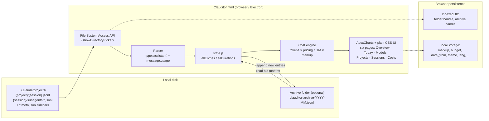
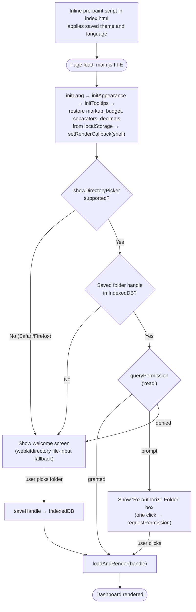
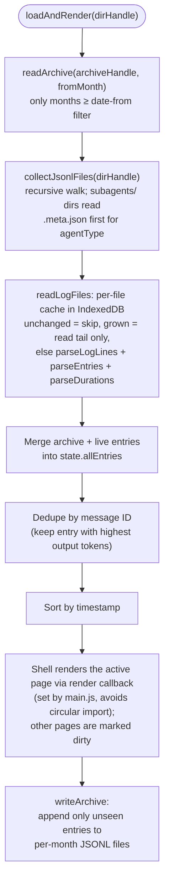
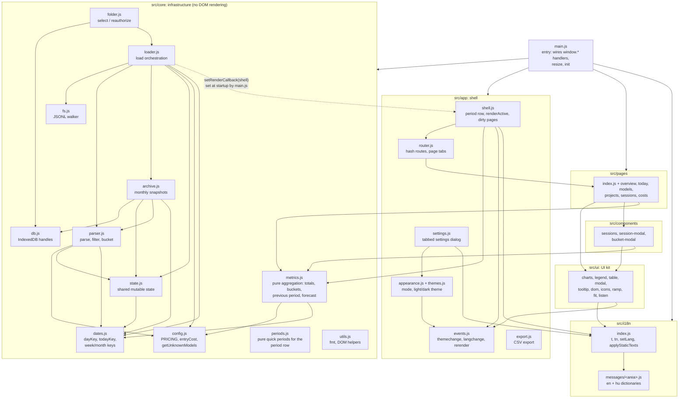
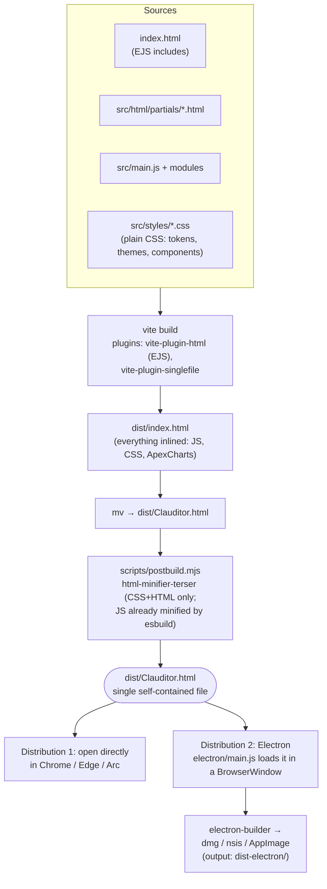

# Clauditor: Architecture & Flow Diagrams

> Companion to [CLAUDE.md](CLAUDE.md) and [README.md](README.md). All diagrams are Mermaid, GitHub renders them natively.

## 1. Big picture: what the app does

Clauditor is a **single-file HTML dashboard** that reads Claude Code's local session logs, computes token costs from Anthropic pricing, and renders charts. Everything runs in the browser; no server, no uploads.

Key facts:

- Only JSONL lines with `type: "assistant"` and a `message.usage` field are counted ([parser.js](src/core/parser.js)).
- Cost is always recomputed from token counts × the pricing table in [config.js](src/core/config.js): the `costUSD` field in the logs is never trusted. Matching is first-hit-wins over version-anchored patterns; models with no exact entry are priced approximately from their family and trigger a visible warning banner (they'd otherwise be silently mispriced).
- An optional markup multiplier (default **×1**, no markup) can be applied on top of the Anthropic base cost.
- All day/week/month bucketing happens in the **viewer's local timezone** via [dates.js](src/core/dates.js): timestamps are UTC instants, and `date` is recomputed from `ts` at parse and archive-read time, so data recorded in any timezone displays consistently.
- Subagent JSONL files get an `agentType` label resolved from `.meta.json` sidecars, powering the per-session agent breakdown.

## 2. Startup & folder authorization flow

## 3. Data-loading pipeline (`loadAndRender`)

Why the dedupe matters: streaming responses write multiple partial `assistant` entries with the same message ID; keeping the max-output one prevents double counting. The identity key lives in exactly one place, `entryKey()` / `durationKey()` in [parser.js](src/core/parser.js), and is shared by the loader dedupe, the archive's append-only writes, and the archive merge, so the three can never drift apart.

## 4. Module dependency graph

Intentional patterns to preserve:

1. **`core/` never imports from `app/`, `ui/`, `components/` or `pages/`.** The one place it needs to trigger rendering, [loader.js](src/core/loader.js) uses a callback injected by [main.js](src/main.js) (`setRenderCallback`).
2. **`window.*` exposure only for the start page.** The start page markup uses `onclick="..."` attributes, so exactly those handlers (`browseCodeFolder`, `browseCoworkFolder`, `onCodeFilesPicked`, `onCoworkPicked`, `openDashboard`, `showSources`, `reauthorize`, `showFreshSelect`, `loadFromFileInput`, `openPricingHelp`, `refreshData`, `selectArchiveFolder`) live in the `Object.assign(window, {...})` block at the bottom of [main.js](src/main.js). Everything else binds with `addEventListener`.
3. **`metrics.js` is pure.** It takes entries and the markup and returns numbers; no state, no DOM. Cost math goes only through `entryCost`, `entryCostByType`, `cacheWrite5m` and `cacheWrite1h`.
4. **No module touches `localStorage` or `document` at import time**, so the Node checks (`check:pricing`, `check:loader`) can import `src/core` (including the pure `pricing-snippets.js`, which `pricing-help.js` also imports).

### Routing and the page contract

Pages are addressed by hash only (the Electron build loads over `file://`): `#overview`, `#today`, `#models`, `#projects`, `#sessions`, `#costs`. The slugs are English in both languages. An unknown or empty hash opens Overview. [router.js](src/app/router.js) registers the pages, builds the tab strip and activates a page; [shell.js](src/app/shell.js) builds the context and renders only the active page. Other pages are marked dirty and render when activated.

A page module `src/pages/<id>/index.js` default-exports `{ id, titleKey, icon, usesRange, render(mount, ctx) }`. `ctx` holds `entries` (the period), `allEntries`, `durations`, `range` (`from`, `to`, `view`), `previous` (the same number of days right before the range: `from`, `to`, `entries`), `markup`, `budget`, `today`, `rerender()` and `openSession(sessionId)`. The shell destroys the charts inside `mount` before each render.

The shell re-renders the active page on three events from [events.js](src/app/events.js): `clauditor:themechange`, `clauditor:langchange` and `clauditor:rerender`.

### Internationalisation

[src/i18n/index.js](src/i18n/index.js) offers `t(key, params)` (current language, then English, then the key), `tn(key, count, params)` for plurals, `setLang`, `getLang`, `getLocale` and `applyStaticTexts` (`data-i18n` and `data-i18n-attr` attributes in the static HTML). Dictionaries are one file per area in `src/i18n/messages/<area>.js` with `en` and `hu` blocks and keys prefixed with the area name. English is the default.

## 5. Build & distribution pipeline

## 6. Where things persist

| What | Where | Key |
|---|---|---|
| Selected `.claude/projects` folder | IndexedDB `clauditor/handles` | `root` |
| Archive folder | IndexedDB `clauditor/handles` | `archiveHandle` |
| Markup multiplier | localStorage | `clauditor_markup` |
| Monthly budget | localStorage | `clauditor_budget` |
| Date-from filter | localStorage | `clauditor_date_from` |
| Period row shown or hidden (`open` or `closed`, default `open`) | localStorage | `clauditor_filters` |
| Dismissed banners (1-month expiry per item) | localStorage | `clauditor_dismissals` |
| Theme mode (`light`, `dark` or `auto`; legacy `winter` reads as `light`, `dracula` as `dark`) | localStorage | `clauditor_theme` |
| Light theme (winter, sand, mint, lavender, sea) | localStorage | `clauditor_theme_light` |
| Dark theme (dracula, midnight, forest, graphite, plum) | localStorage | `clauditor_theme_dark` |
| Language (`en` or `hu`, default `en`) | localStorage | `clauditor_lang` |
| Table page sizes (JSON map) | localStorage | `clauditor_table_rows` |
| Page width (`narrow`, `normal`, `wide`, `full`, default `normal`) | localStorage | `clauditor_width` |
| Thousands separator, decimal separator, decimal places | localStorage | `clauditor_thousands_sep`, `clauditor_decimal_sep`, `clauditor_money_decimals` |
| Date-from reset step | localStorage | `clauditor_datefrom_reset` |
| Open settings tab | sessionStorage | `clauditor_settings_tab` |
| Historical usage data | Archive folder on disk | `clauditor-archive-YYYY-MM.jsonl` |
